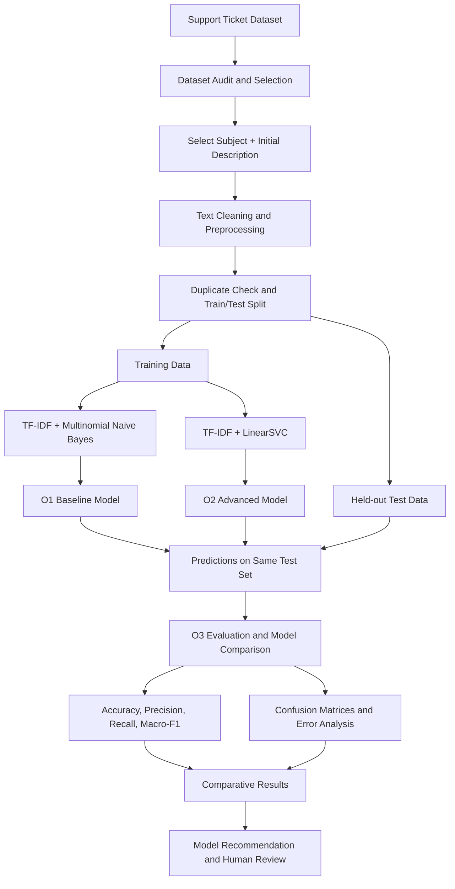
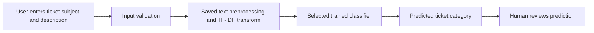

# TicketIQ: V1 Architecture Specification, Decisions, and Traceability

**Version:** 2.0  
**Status:** Revised Week 2 Conceptual V1 Architecture

---

## Step C1 - Starting with the Simplest Architecture

### 1. Baseline Simple Flow

Support Ticket (Subject + Initial Description) -> Text Preprocessing -> TF-IDF Features -> Baseline Classifier -> Predicted Ticket Category

### 2. What the Simple Architecture Can Do

- Accepts a support ticket's subject and initial description.
- Converts the text into numerical TF-IDF features.
- Uses one trained baseline model to predict a predefined ticket category.
- Returns the predicted category for human review.
- Keeps the first implementation small and suitable for a one-semester project.

### 3. Why the Baseline-Only Architecture Is Not Enough

- **Does not fulfil O2:** A single baseline classifier cannot demonstrate the development of a second advanced model.
- **Does not fulfil O3:** Without a second model evaluated under the same conditions, the project cannot perform its intended model comparison.
- **Limited evidence of model suitability:** One model's score alone does not show whether another practical classical approach performs better or worse on the same dataset.

The solution is not to add unrelated capabilities such as historical-ticket retrieval. Instead, TicketIQ will retain one classification task and add a second classifier that uses the same input data and target categories.

### 4. Data Preparation and Leakage Prevention

- Inspect the dataset before selecting the final target category.
- Use only fields available when the ticket is initially submitted.
- Exclude resolution text, closing notes, and other post-submission fields from model inputs.
- Check and remove exact or near-duplicate records before splitting the dataset.
- Create a training set and held-out test set using stratified sampling where class counts permit.
- Fit text preprocessing and TF-IDF vocabulary on training data only.
- Keep the held-out test set separate from model fitting and hyperparameter tuning.
- Evaluate both models using exactly the same test records and label mapping.

---

## Step C2 - Identifying Architecture Needs from Requirements

| Requirement ID | What Does the Requirement Need? | Architecture Response |
|---|---|---|
| FR1, FR2, RAI1, RAI2 | Accept ticket subject and initial description, validate text, and exclude unnecessary personal or post-submission fields. | Ticket Input and Data Validation |
| FR2, RAI2, RAI4 | Clean selected text, create a consistent representation, and prevent test-data leakage and duplicate contamination. | Data Preprocessing and Split Pipeline |
| O1, FR3 | Train a baseline classifier using selected ticket text and predefined category labels. | O1 Baseline Model: TF-IDF + Multinomial Naive Bayes |
| O2, FR4 | Train an advanced classifier using the same input fields and target categories. | O2 Advanced Model: TF-IDF + LinearSVC |
| O3, FR5, NFR1, NFR2, RAI3 | Evaluate both models on the same held-out test set and compare overall and per-class performance. | O3 Evaluation and Model Comparison |
| NFR3, NFR4, NFR5, RAI5 | Support repeatable local execution, record prediction performance, avoid paid AI APIs, and present predictions for human review. | Prototype Interface, Experiment Configuration, and Result Logging |

---

## Step C3 - V1 Conceptual Architecture Overview

The architecture uses two parallel model-training paths after a shared data-preparation stage. Both models solve the same classification problem and are evaluated using the same held-out test records.

### 1. Main Components

1. **User / Support Agent:** Supplies a support ticket's subject and initial description, or reviews a sample ticket during experimentation.
2. **Ticket Input:** Accepts the selected text fields and checks that the input is not empty.
3. **Dataset Audit and Selection:** Checks candidate dataset fields, missing values, duplicate records, category labels, class distribution, and reuse conditions.
4. **Data Preprocessing:** Combines selected text fields, applies consistent text cleaning, and prepares data for TF-IDF transformation.
5. **Data Split and Leakage Control:** Separates training and held-out test records after duplicate checks. Test records remain unavailable to model fitting and tuning.
6. **O1 Baseline Model:** Uses TF-IDF features with Multinomial Naive Bayes to establish baseline classification performance.
7. **O2 Advanced Model:** Uses TF-IDF features with LinearSVC to provide a second classification approach for the same task.
8. **O3 Evaluation and Comparison:** Evaluates both models on the same held-out test records using accuracy, precision, recall, macro-F1, and confusion matrices.
9. **Prediction Output / Human Review:** Displays the predicted category and makes clear that the result is a model suggestion rather than a guaranteed decision.

### 2. Conceptual Architecture Diagram



### 3. Runtime Prediction Flow



The training/evaluation architecture contains both models. The demonstration interface may expose one selected model for prediction or allow a user to compare both outputs. Any displayed prediction must be labelled as a model-generated suggestion.

---

## Step C4 - Architecture Decision Record (ADR) and Traceability

### 1. Architecture Decision Record (ADR)

| Decision | Requirement / Constraint | Alternatives Considered | Selected Option | Trade-off Accepted |
|---|---|---|---|---|
| ADR 1: Classical Baseline Model | O1, FR3, NFR5 — establish a simple baseline without paid AI APIs or GPU requirements. | 1. TF-IDF + Multinomial Naive Bayes. 2. Deep-learning text classifier. 3. External hosted language-model API. | Option 1: TF-IDF + Multinomial Naive Bayes. | Computationally efficient and practical, but simplifying assumptions may limit performance on complex language patterns. |
| ADR 2: Advanced Classical Model | O2, FR4, NFR5 — develop a second classifier while keeping implementation feasible within one semester. | 1. TF-IDF + LinearSVC. 2. Fine-tuned transformer. 3. External hosted language-model API. | Option 1: TF-IDF + LinearSVC. | Learns discriminative boundaries in sparse text features and is practical for local training. It may require parameter tuning and does not provide native calibrated probabilities by default. |
| ADR 3: Shared Experimental Conditions | O3, FR5, NFR2, RAI2, RAI4 — ensure fair comparison and prevent test-data leakage. | 1. Different splits for each model. 2. Same held-out test set and target labels for both models. | Option 2: Same dataset, target labels, test records, and evaluation metrics. | Constrains both models to the same experiment but makes comparison more meaningful and reproducible. |
| ADR 4: Local-First Implementation | NFR5, RAI1 and one-semester constraint — avoid paid external AI services and unnecessary infrastructure. | 1. Hosted commercial AI API. 2. Local scikit-learn pipeline. | Option 2: Local scikit-learn implementation. | Reduces external API cost and infrastructure complexity, but performance depends on local hardware and dataset size. |

### 2. Initial Requirements Traceability Matrix

| Objective | Requirement | Evaluation Criterion | Architecture Element | Later Evidence |
|---|---|---|---|---|
| O1 | FR1, FR2, FR3, RAI1, RAI2, RAI4 | Baseline classification report: accuracy, precision, recall, macro-F1, confusion matrix. | Ticket Input, Preprocessing Pipeline, O1 Baseline Model. | Prepared dataset, training notebook/script, baseline classification report. |
| O2 | FR1, FR2, FR4, RAI1, RAI2, RAI4 | Advanced classification report using the same metrics and test records as O1. | Ticket Input, Preprocessing Pipeline, O2 Advanced Model. | Advanced-model training notebook/script and classification report. |
| O3 | FR5, NFR1, NFR2, RAI3 | Side-by-side metric comparison and per-class error analysis. | O3 Evaluation and Model Comparison. | Comparative results table, confusion matrices, and error analysis. |
| O1, O2, O3 | NFR3, NFR4, NFR5, RAI5 | Repeatability, prediction latency, external API cost, and human-review wording. | Experiment Configuration, Prototype Interface, Result Logging. | Re-run evidence, latency record, dependency list, and prototype demonstration. |

### 3. Final V1 Architecture Review Checklist

- **Does each major component support an objective or requirement?**  
  Yes. The shared data pipeline supports both classifiers, the two model components fulfil O1 and O2, and the evaluation component fulfils O3.
- **Are both models solving the same task?**  
  Yes. Both models use the same selected ticket text fields and target category labels.
- **Is the comparison fair?**  
  It will be fair if both models use the same held-out test records, label mapping, and evaluation metrics, with no test-data fitting or tuning.
- **Has unnecessary complexity been avoided?**  
  Yes. Historical retrieval, resolution recommendation, chatbot functionality, and deep-learning fine-tuning are excluded from V1.
- **Is the dataset confirmed?**  
  Not yet. The candidate dataset and target label must pass the data audit before implementation is finalised.

---

## Part C Reflection

**Question:** Which architecture decision involved the most important trade-off? Which requirement drove the decision, and what trade-off did you accept?

**Reflection:**

The most important architecture decision is the selection of two classical machine-learning models under the same experimental conditions. This decision is driven by O1, O2, and O3, which require a baseline model, an advanced model, and a fair comparison between them.

A transformer-based model or hosted language model could introduce additional complexity, compute requirements, and external dependencies that are difficult to justify for a one-semester prototype.

Therefore, TicketIQ will use TF-IDF with Multinomial Naive Bayes as the baseline and TF-IDF with LinearSVC as the advanced model.

The trade-off is that these classical models may not capture deeper semantic relationships as effectively as some modern neural approaches. However, they are practical to implement, can run locally, and allow the project to focus on a controlled experiment.

The advanced model is not assumed to be better; its suitability will be determined from the held-out evaluation results.
```
